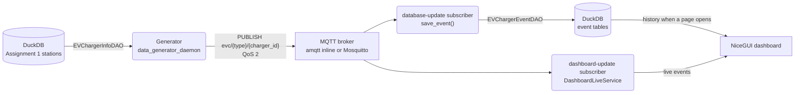

# NSW EV Charging: Data Pipeline, Event Streaming and Live Dashboard

<!-- USYD CODE CITATION ACKNOWLEDGEMENT: Claude (Anthropic) assisted with revising this document. -->

This project cleans, augments and loads NSW EV charging station data into a DuckDB database
with spatial support, then simulates charging activity on those stations and streams it as
events through MQTT to an event store and a live map dashboard.

## Project Overview

**Assignment 1: a three-stage data pipeline** (`main_ass_1.py`)

1. **Data Cleaning**: validates and cleans raw NSW EV charging station data
2. **Data Augmentation**: enriches it with external sources and address details
3. **Data Loading**: loads it into a DuckDB database with spatial support

**Assignment 2: an event-driven publish–subscribe system** (`main_ass_2.py`)

1. **Generate**: simulate charging sessions, meter readings and prices for the Assignment 1 stations
2. **Publish**: send each event to an MQTT broker
3. **Store**: a subscriber validates each event and saves it in DuckDB
4. **Show**: a second subscriber updates a live NiceGUI map dashboard

## System Requirements

- **Python**: 3.12 or higher (numpy 2.5 needs 3.12; tested with Python 3.14.3)
- **Operating System**: Windows, macOS, or Linux
- **Disk Space**: ~500MB for raw data and ~200MB for processed outputs
- **Memory**: 4GB RAM minimum (8GB recommended)
- **Optional**: Docker Desktop, to run a Mosquitto broker instead of the built-in one;
  Node.js, for one dashboard JavaScript test

## Installation

### 1. Extract the Project

Extract the project .zip file to your desired location:

On Windows: Right-click the .zip file and select "Extract All..."
On macOS/Linux: unzip COMP5339-EVCharger.zip

### 2. Create Virtual Environment

On Windows:
```
python -m venv .venv
.\.venv\Scripts\activate
```

On macOS/Linux:
```
python3 -m venv .venv
source .venv/bin/activate
```

### 3. Install Dependencies

```
pip install -r requirements.txt
pip install -r requirements-dashboard.txt
```

| Package | Used for |
|---|---|
| pandas, numpy | Data manipulation and CSV processing |
| geopandas, shapely, pyogrio, pyproj | Geospatial data, shapefiles and coordinate conversion |
| duckdb | Embedded SQL database with the spatial extension |
| requests, pytz | Downloads and time zones |
| paho-mqtt | MQTT client for publishing and subscribing |
| amqtt | Built-in (inline) MQTT broker used by `main_ass_2.py` |
| nicegui (`requirements-dashboard.txt`) | Live dashboard |

Exact versions are pinned in `requirements.txt`.

### 4. Data Files

Place source data files in the data/src_data/ directory:
- nsw_ev_charging.csv

Other directories will be created automatically:
- data/clean_src_data/ - Cleaned output
- data/aug_data/ - Augmented output
- data/db/ - Database files
- data/result_data/ - Final results
- data/ass2_demo/, data/ass2_generated/ - Assignment 2 generated datasets

## Configuration

File locations are centralized in config.py. Key settings:

```
PROJECT_ROOT = Path(__file__).parent.resolve()
DATA_ROOT = PROJECT_ROOT / "data"
SRC_DATA_FILE_LOCATION = DATA_ROOT / "src_data"
CLEAN_SRC_DATA_FILE_LOCATION = DATA_ROOT / "clean_src_data"
AUG_DATA_FILE_LOCATION = DATA_ROOT / "aug_data"
RESULT_DATA_FILE_LOCATION = DATA_ROOT / "result_data"
# Assignment 2
ASS2_GENERATED_DATA_FILE_LOCATION = DATA_ROOT / "ass2_generated"
ASS2_DEMO_DATA_FILE_LOCATION = DATA_ROOT / "ass2_demo"
```

Database files are set in config.py too:

```
DB_ROOT = PROJECT_ROOT / "db"
DB_SCHEMA = DB_ROOT / "schema" / "nsw_evc_schema.sql"                # Assignment 1 tables
DB_EVENTS_SCHEMA = DB_ROOT / "schema" / "nsw_evc_events_schema.sql"  # Assignment 2 event tables
DB_DATA = DATA_ROOT / "db" / "nsw_evc.db"                            # one database for both
```

Assignment 2 settings:

```
MQTT_HOST = "localhost"            # broker host
MQTT_PORT = 1883
MQTT_TOPIC_ROOT = "evc"            # topics are evc/{event_type}/{charger_id}
MQTT_QOS = 2                       # every publisher and subscriber
MQTT_PUBLISH_INTERVAL_SECONDS = 1  # minimum gap between published events
DASHBOARD_PORT = 8081
```

These environment variables override config.py without editing it:

| Variable | Overrides |
|---|---|
| `COMP5339_DB_DATA` | `DB_DATA`, the database file |
| `MQTT_HOST`, `MQTT_PORT` | The broker address, e.g. another computer's LAN IP |
| `DASHBOARD_PORT` | The dashboard's HTTP port |
| `ADDRESS_ENRICHER_ALLOW_NETWORK` | Set to `1` to let address enrichment call online geocoding; otherwise it uses its cache |

All paths are absolute and portable across different working directories and operating systems.

## Assignment 1: Running the Pipeline

Run every command from the repository root.

### Quick Start

Run the complete pipeline:
```
python main_ass_1.py
```

This executes all stages sequentially:
1. Data cleaning
2. Data augmentation
3. Database loading

### Running Individual Stages

```
python main_ass_1.py --stage clean
python main_ass_1.py --stage augment
python main_ass_1.py --stage load
```

## Database Schema

Assignment 1 creates 6 tables ([`db/schema/nsw_evc_schema.sql`](db/schema/nsw_evc_schema.sql)):

### operator
- operator_id (INTEGER, PRIMARY KEY)
- operator_name (VARCHAR)
- operator_name_normalised (VARCHAR)

### sa4_region
- sa4_code (VARCHAR, PRIMARY KEY)
- sa4_name (VARCHAR)
- geometry (GEOMETRY) - ABS SA4 boundary

### charger_location
- charger_id (INTEGER, PRIMARY KEY)
- source_objectid (BIGINT)
- station_name (VARCHAR)
- station_address (VARCHAR)
- operator_id (INTEGER, FOREIGN KEY → operator.operator_id)
- latitude (DOUBLE)
- longitude (DOUBLE)
- postcode (VARCHAR)
- lga_name (VARCHAR)
- source_category (VARCHAR)
- geom (GEOMETRY) - point geometry in GDA2020 (EPSG:7844)
- sa4_code (VARCHAR, FOREIGN KEY → sa4_region.sa4_code; NULL when no region was confirmed)

### charger_characteristic
- charger_id (INTEGER, PRIMARY KEY, FOREIGN KEY → charger_location.charger_id)
- charger_type (VARCHAR)
- number_of_plugs (INTEGER)
- rating_raw (VARCHAR)
- rating_kw (DOUBLE) - Normalized power rating

### charger_connector
- charger_connector_id (INTEGER, PRIMARY KEY)
- charger_id (INTEGER, FOREIGN KEY → charger_location.charger_id)
- connector_type (VARCHAR)
- UNIQUE(charger_id, connector_type)

### charger (Augmentation Records)
- augmentation_id (INTEGER, PRIMARY KEY)
- charger_id (INTEGER, FOREIGN KEY → charger_location.charger_id)
- external_source (VARCHAR)
- external_station_id (VARCHAR)
- external_operator (VARCHAR)
- external_number_of_plugs (INTEGER)
- external_power_kw_min (DOUBLE)
- external_power_kw_max (DOUBLE)
- external_usage_cost (VARCHAR)
- augmentation_match_method (VARCHAR)
- augmentation_match_confidence (DOUBLE)
- augmentation_quality_review_reason (VARCHAR)
- external_opening_hours (VARCHAR)
- external_network (VARCHAR)
- external_access_condition (VARCHAR)
- external_is_free (BOOLEAN)
- augmentation_quality_review (BOOLEAN)
- external_attributes_json (JSON)

### Assignment 2 event tables

Assignment 2 adds `charger_event` (the event log), `charger_state` and `connector_state`
(the latest state of each charger and connector) to the same database
([`db/schema/nsw_evc_events_schema.sql`](db/schema/nsw_evc_events_schema.sql)). They are
created automatically on the first `main_ass_2.py` run and are described in
[`docs/ass2_event_schema.md`](docs/ass2_event_schema.md).

## Data Processing Details

### Address Enrichment

The pipeline enriches addresses using geolocation services:
- Converts latitude/longitude to detailed addresses
- Matches partial addresses to complete addresses
- Fills in missing postcode information

Results are cached in `data/result_data/task2_nominatim_cache.json`. Online lookups run only
when `ADDRESS_ENRICHER_ALLOW_NETWORK=1`.

### Charger Location Storage

Charger locations are stored with:
- Point geometry in GDA2020 (EPSG:7844), converted from the source's WGS84 (EPSG:4326) coordinates
- Operator mapping
- Postcode, LGA and SA4 region

## Output Files

After running the pipeline:

1. **data/clean_src_data/nsw_ev_charging.csv** (~8MB)
   - Cleaned NSW data with validated columns
   - Enriched addresses
   - Standardized data types

2. **data/aug_data/nsw_ev_charging.csv** (~15MB)
   - Augmented data with external sources
   - Match confidence scores
   - Review flags

3. **data/db/nsw_evc.db** (~30MB)
   - Complete DuckDB database
   - Spatial indexes

## Assignment 2: Event Streaming and Dashboard

### Quick Start

The database must hold the Assignment 1 tables. The committed `data/db/nsw_evc.db` has them;
otherwise run `python main_ass_1.py` first. Then:

```
python main_ass_2.py
```

One process then:

1. starts a built-in MQTT broker (amqtt) on `localhost:1883`;
2. starts two subscribers to `evc/#`: `database-update`, which stores events, and
   `dashboard-update`, which feeds the dashboard;
3. serves the dashboard at <http://127.0.0.1:8081/>;
4. generates a small demo dataset (3 stations, 1 day) in `data/ass2_demo/`, waits 10 seconds
   so you can open the dashboard, and publishes each event once.

The dashboard stays open after publishing; stop it with Ctrl+C. Each default run replaces the
previous demo dataset but keeps its downloaded AEMO prices.

| Option | Effect |
|---|---|
| `--external-broker` | Use a broker that is already running (e.g. Mosquitto) instead of the built-in one |
| `--host`, `--port` | The broker address |
| `--dashboard-port`, `--dashboard-host` | Where the dashboard listens |
| `--dashboard-delay SECONDS` | Wait before publishing (default 10) |
| Any generator option | Passed to the generator instead of the demo settings, e.g. `--out data/ass2_generated --days 3` |

More detail: [unified entry point](docs/part_c_unified_entrypoint.md).

### Architecture



The broker decouples the generator from the two subscribers, and each subscriber receives its
own copy of every event. Only `database-update` writes to DuckDB. The generator and the
dashboard read through the same process-wide connection, because DuckDB lets only one process
open the file read-write. The full data-flow and sequence diagrams are in
[`docs/ass2_pubsub_data_flow.md`](docs/ass2_pubsub_data_flow.md).

The code is layered:

| Layer | Folder | Contents |
|---|---|---|
| Presentation | `view/` | NiceGUI dashboard |
| Application | `transaction_scripts/`, `main_ass_2.py` | Generate and publish; store events; wiring |
| Domain | `event/`, `entity/` | `YEvent`, `EVChargerStateEvent`, `EVCharger`, `EVChargerState` |
| Data access | `repository/` | `EVChargerEventDAO`, `EVChargerInfoDAO`, shared DuckDB connection |
| Infrastructure | `data_utils/` | MQTT client, inline broker and subscribers; DuckDB connection wrappers; file helpers |

Design patterns used:

- **Publish–subscribe** over MQTT (Eugster et al., 2003; Hohpe & Woolf, 2003).
- **Transaction Script** for storing events, and **Domain Model** for the state rules in
  `EVChargerState.apply()` (Fowler, 2002).
- **Data Access Object** for all SQL (Alur et al., 2003).
- **Event log with stored state**: `charger_event` is append-only, the state tables are
  updated in the same transaction, and a charger's state is rebuilt by replaying its events
  after a restart (Fowler, 2005).
- **Idempotent receiver**: event ids are stable, so replays and redeliveries are skipped
  (Hohpe & Woolf, 2003).
- **Observer** callbacks for subscribers and **Adapter** around the supplied generator
  (Gamma et al., 1994).

`YSimpleMqttRepository`, `DuckDBRepository` and `SharedDuckDBRepository` are named
"Repository" but act as gateways and connection wrappers, not Repositories in the
Domain-Driven Design sense; the DAOs do the data access.

### Dashboard

The dashboard shows the NSW charging network on a map, with markers coloured by status
(available, charging, full, unknown). Selecting a station shows its connectors, current
session, price and connector timeline. It also has live charging monitoring, historical
analytics (events by type, top stations by completed sessions) and a run selector with a
Live button.

To run the dashboard on its own against an already-running broker (it reads the database but
stores nothing):

```
python -m view.dashboard_daemon
```

### Events

Topics are `evc/<event_type>/<charger_id>`, published and subscribed at QoS 2. Each payload is
a JSON `EVChargerStateEvent` with `run_id`, `id`, `type`, `ts`, `object_id`, `session_id`,
`connector_id` and `payload`. The four types are `price_update`, `session_start`, `meter` and
`session_end`. `object_id` is the Assignment 1 `charger_id` as text;
`EVChargerStateEvent.charger_id` returns it as an integer. Each event id is a UUID derived
from the run, type, charger, session, connector and time, so replaying a run resends the same
ids; compare unique `id` counts for the same `run_id`.

### Using a Mosquitto broker on the LAN

For a broker on A's computer, follow the [LAN MQTT setup](mqtt/README.md): start Docker
Desktop and run `docker compose -f compose.mqtt.yaml up -d`. A connects to `127.0.0.1:1883`;
B on another computer on the same LAN connects to A's LAN IP on port `1883` (set `MQTT_HOST`).
Run `main_ass_2.py --external-broker` to use it. For B's integration, read the
[A to B handoff](docs/ass2_a_to_b_handoff.md).

### Data generator

The generator files are in `transaction_scripts/data_generation_and_publishing/`
and follow Yeh's layout:

- `data_generator_config.py`: dates, paths, seed and simulation settings.
- `data_generator_utils.py`: station adaptation, AEMO prices, CSV generation and ordered events.
- `data_generator_replay.py`: turns a dataset back into events, optionally for a time window.
- `data_generator_daemon.py`: reads stations through `EVChargerInfoDAO`, runs generation,
  and optionally publishes events using Paho MQTT.

MQTT defaults come from `config.py` through `repository.repo_config.mqtt_config()`;
CLI options override them. The configuration keys match Yeh's helpers, while the
shared topic root remains `evc`. Station reads through `DuckDBRepository` are read-only;
inside `main_ass_2.py` the generator reads through the shared connection instead.

The supplied `generate_dataset.py` is kept separately in the same directory. The wrapper
calls its price loader, tariff, arrival sampler and session simulator instead of
maintaining a second implementation in `utils`. The supplied copy has documented
project adaptations for complete observed prices, macOS CA certificates, AC charging,
power caps and the final meter reading. Use the daemon or `main_ass_2.py` as the entry point.

Run these commands from the repository root. The database defaults to `data/db/nsw_evc.db`;
pass `--db` to use another Assignment 1 database.

```bash
# Small offline run for integration.
python -m transaction_scripts.data_generation_and_publishing.data_generator_daemon \
  --out data/ass2_small --start 2026-09-15 --days 14 --limit 2 --meter-every 5

# Full offline run, kept separate from the small one.
python -m transaction_scripts.data_generation_and_publishing.data_generator_daemon \
  --out data/ass2_generated --start 2026-09-15 --days 14 --meter-every 5

# Publish an existing dataset to a running broker. Start a subscriber first, e.g.
# `python -m view.dashboard_daemon`. Replace localhost with the broker's IP if it is remote.
python -m transaction_scripts.data_generation_and_publishing.data_generator_daemon \
  --out data/ass2_small --replay --publish --host localhost --port 1883
```

Without options, the generator writes 3 days starting on the 15th of the previous completed
month, for every eligible DC station, with a meter reading every 2 minutes, to
`data/ass2_generated/`. `--charger-type all` includes AC stations, and `--limit N` keeps the
first N stations. Every session keeps its last meter reading. An existing dataset is never
overwritten: use a new `--out`, or `--replay` to reuse it.

Publishing sends one event at a time and waits for the broker's acknowledgement. Events are at
least `MQTT_PUBLISH_INTERVAL_SECONDS` (1 second) apart; `--interval` can lower this to 0.1
seconds. A large dataset can therefore take days to publish.

Outputs are `stations_input.csv`, `stations.csv`, `prices_hourly.csv`, `sessions.csv`,
`session_metering.csv` and `manifest.json`, plus an `aemo_cache` directory. With `--publish`
or `--export-events`, `prepared_events.json` holds every event; with `--publish`,
`published_events.json` holds the acknowledged ones. The manifest records the run ID, seed,
period, source and counts.

Prices use real AEMO `TRADE`/`ACTUAL` five-minute observations, averaged hourly and
converted from AUD/MWh to AUD/kWh. Missing intervals cause an error instead of silently
filling prices. All source times use fixed AEST (UTC+10); event entities normalize them to
UTC. Only the first price and actual retail-price changes are published. Event ordering
preserves final meter readings, session endings and subsequent reuse of the same connector.

Simulation assumptions are explicit. Only stations of type AC or DC with a positive plug
count, at least one connector record and an augmentation record generate events, and each
plug becomes one simulated connector. All sites use the configured urban default. A missing
power rating defaults to 7 kW AC or 50 kW DC, and each station's assumptions are recorded in
`stations.csv`. AC uses an assumed 11 kW onboard limit, 90% efficiency and a 16-hour cap; DC
follows the supplied teaching script's vehicle mix and taper model with a 4-hour cap. These
are synthetic assumptions, not observed station behaviour.

The [full validation summary](docs/ass2_full_validation.json) records offline results, and a
[real-broker check](docs/ass2_mqtt_validation.json) of an earlier two-station sample
passed with 4,191 published and received events. Full dataset publication remains pending.

The implementation adapts the supplied COMP5339 `generate_dataset.py`, with AI
assistance acknowledged in the source files. References for the time convention and
MQTT acknowledgement API: [AEMO market time](https://markets-portal-help.docs.public.aemo.com.au/Content/MSATSb2bValidationModule/RulesProcedures.htm),
[Paho Python client](https://eclipse.dev/paho/files/paho.mqtt.python/html/client.html).

### Compact dashboard dataset and replay

The optional coverage-controlled mode is documented in
[`docs/ass2_dashboard_dataset_v2.md`](docs/ass2_dashboard_dataset_v2.md). It supports
DC-only filtering, exact target session counts, Sydney focus-region coverage, stable
JSON export, and time-window replay with only the required preceding state context.
It preserves the existing Poisson-style generator when `--target-sessions` is omitted.

Use a new ignored output directory when generating data. The three-day dataset and
MQTT validation artifacts referenced by the documentation are not committed here:
their presence must be verified separately.

## Running the Tests

From the repository root:

```
python -m unittest discover -s tests
```

One dashboard test runs a Leaflet component check with Node.js and fails if Node.js is not
installed.

## Project Structure

```text
COMP5339-EVCharger/
├── main_ass_1.py                # Assignment 1: clean → augment → load
├── main_ass_2.py                # Assignment 2: broker, generator, storage and dashboard in one run
├── config.py                    # Paths, MQTT and dashboard settings
├── README.md                    # This file
├── requirements.txt             # Pipeline, generator and MQTT dependencies
├── requirements-dashboard.txt   # NiceGUI for the dashboard
├── compose.mqtt.yaml            # Optional Mosquitto broker (Docker)
├── pipeline/                    # Assignment 1 stages: data_clean, data_aug, data_load
├── event/                       # Event types: YEvent, EVChargerStateEvent
├── entity/                      # Domain entities: EVCharger, EVChargerState
├── repository/                  # DAOs and the shared DuckDB connection (utils/)
├── transaction_scripts/
│   ├── data_generation_and_publishing/  # Generator, replay and publisher
│   └── stateful_event_storage/          # Event storage for the database-update subscriber
├── view/                        # NiceGUI dashboard
├── data_utils/                  # MQTT client, broker and subscribers; DuckDB and file helpers
├── db/
│   └── schema/
│       ├── nsw_evc_schema.sql          # Assignment 1 tables
│       └── nsw_evc_events_schema.sql   # Assignment 2 event tables
├── mqtt/                        # Mosquitto configuration and LAN setup guide
├── docs/                        # Design notes, diagrams and validation records
├── tests/                       # unittest suite
└── data/                        # All data files (auto-created)
    ├── src_data/                # Source data
    ├── clean_src_data/          # Cleaned output
    ├── aug_data/                # Augmented output
    ├── result_data/             # Final results
    ├── db/                      # Database files
    ├── ass2_demo/               # main_ass_2.py demo dataset
    └── ass2_generated/          # Full generated dataset
```
