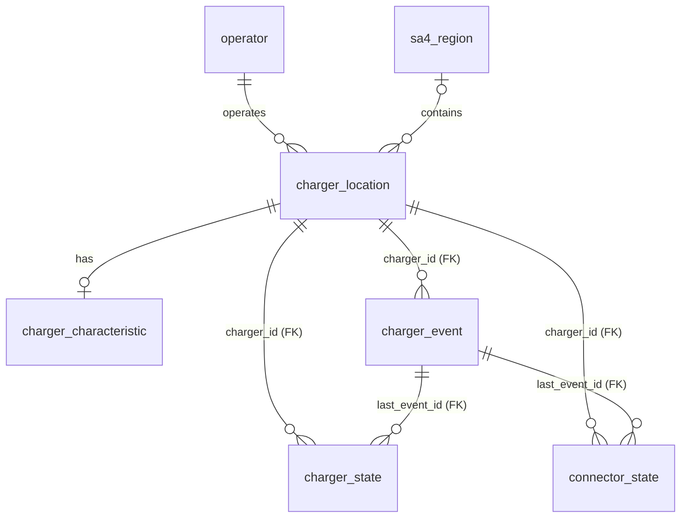

# Assignment 2 event storage: schema extension and design decisions

<!-- USYD CODE CITATION ACKNOWLEDGEMENT: Claude (Anthropic) assisted with this document. -->

The `database-update` subscriber in `main_ass_2.py` stores every MQTT charger event in the
Assignment 1 DuckDB database, `data/db/nsw_evc.db`. The extension adds three tables, each
referencing Assignment 1's `charger_location` by `charger_id`:

- `charger_event`: the event log, one row per unique event.
- `charger_state`: the latest state of each charger.
- `connector_state`: the latest state of each connector.

| Part | File |
|---|---|
| DDL: drops and recreates the three tables | [`db/schema/nsw_evc_events_schema.sql`](../db/schema/nsw_evc_events_schema.sql) |
| Paths: `DB_EVENTS_SCHEMA`, `DB_DATA` | [`config.py`](../config.py), next to Assignment 1's `DB_SCHEMA` |
| Data access: `EVChargerEventDAO` | [`repository/evc_event_dao.py`](../repository/evc_event_dao.py) |
| Writer: `prepare_event_storage()` and `save_event()`, a plain transaction script | [`transaction_scripts/stateful_event_storage/save_subscribed_data.py`](../transaction_scripts/stateful_event_storage/save_subscribed_data.py) |
| Subscriber callback: `sub_database_update()` | The same file; [`main_ass_2.py`](../main_ass_2.py) registers it |
| Tests | [`tests/test_event_storage.py`](../tests/test_event_storage.py) |

The Assignment 1 schema ([`nsw_evc_schema.sql`](../db/schema/nsw_evc_schema.sql)) is unchanged.

## 1. Entity-relationship diagram



- Each Assignment 1 charger has any number of events, one `charger_state` row, and one
  `connector_state` row per connector it has used.
- Joining through `charger_location` adds the station name, location, operator, SA4 region and
  charger type.
- Each state row also points to the event that last changed it.

All timestamps are `TIMESTAMPTZ` and are stored as UTC instants.

## 2. `charger_event`: the event log

- **Grain:** one row per unique MQTT event. Rows are never updated.
- **Primary key:** `event_id`.
- **Foreign key:** `charger_id` → `charger_location(charger_id)`.
- **Indexes:** `event_type`, `event_ts`, `charger_id`, `connector_no` (D4).

| Column | Type | Event types | Meaning |
|---|---|---|---|
| `event_id` | `UUID` PK | all | MQTT `id`. It is stable across replays, so a repeated event is skipped. |
| `run_id` | `VARCHAR` | all | Data-generation run. Regenerating the data creates a new one. |
| `event_type` | `charger_event_type` ENUM | all | Declared in the publisher's same-time order: `price_update`, `meter`, `session_end`, `session_start` (D9). |
| `event_ts` | `TIMESTAMPTZ` | all | When it happened. For `session_end` this is the unplug time. |
| `charger_id` | `INTEGER` FK | all | The Assignment 1 charger: MQTT `object_id` as an integer (`EVChargerStateEvent.charger_id`). |
| `connector_no` | `SMALLINT` | session events | Simulated port 1..n. This is **not** `charger_connector`'s key (D7). |
| `session_id` | `VARCHAR` | session events | Unique within a run. |
| `price_per_kwh` | `DECIMAL(8,4)` | price_update, session_start, session_end | AUD/kWh. The session price is fixed when the session starts. |
| `wholesale_per_kwh` | `DOUBLE` | price_update | NEM hourly average in AUD/kWh; may be negative. |
| `vehicle_model` | `VARCHAR` | session_start | |
| `power_kw` | `DOUBLE` | meter | |
| `energy_kwh` | `DOUBLE` | meter, session_end | On a meter row: **cumulative within the session**, never summed across readings. On a `session_end` row: the session total. |
| `voltage_v`, `current_a`, `soc_pct` | `DOUBLE` | meter | State of charge as a percentage, 0–100. |
| `charge_end_ts` | `TIMESTAMPTZ` | session_end | When charging stopped. `event_ts − charge_end_ts` is idle time while still plugged in. |
| `charge_minutes` | `DOUBLE` | session_end | |
| `cost_aud` | `DECIMAL(10,2)` | session_end | |
| `avg_kw`, `peak_kw` | `DOUBLE` | session_end | |

A payload column is `NULL` when the event type has no such field. A `CHECK` constraint requires
`connector_no > 0` and a `session_id` on every event except `price_update`.

## 3. `charger_state`: latest state per charger

- **Grain:** one row per charger, rewritten by every event of that charger.
- **Primary key:** `charger_id`.
- **Foreign keys:** `charger_id` → `charger_location`, `last_event_id` → `charger_event`.
- **Index:** `price_updated_ts`.

| Column | Type | Meaning |
|---|---|---|
| `run_id` | `VARCHAR` | Run of the charger's latest event (D6). |
| `price_per_kwh` | `DECIMAL(8,4)` | Current retail price. `NULL` until the run's first `price_update` for this charger. |
| `wholesale_per_kwh` | `DOUBLE` | NEM price at the last `price_update`. |
| `price_updated_ts` | `TIMESTAMPTZ` | When the current price took effect. |
| `active_sessions` | `SMALLINT` | Connectors occupied now, including the idle time before unplugging. |
| `last_event_id`, `last_event_type`, `last_event_ts` | `UUID` FK, ENUM, `TIMESTAMPTZ` | The charger's latest event. |

Only a `price_update` changes the three price columns, except that the first event of a new run
resets them, so a run never shows another run's price. Session events change `active_sessions`.
Every event updates `run_id` and the `last_event_*` columns.

## 4. `connector_state`: latest state per connector

- **Grain:** one row per connector of a charger, rewritten by every session event on that
  connector. A connector gets its row with its first session.
- **Primary key:** `(charger_id, connector_no)`. The port number alone is not unique: every
  charger has a connector 1, so `connector_no` on its own would make all chargers share one row
  per port number.
- **Foreign keys:** `charger_id` → `charger_location`, `last_event_id` → `charger_event`.
- **Indexes:** `charger_id`, `run_id`, `session_start_ts`, `status`.

| Column | Type | Meaning |
|---|---|---|
| `connector_no` | `SMALLINT` | Simulated port 1..n (D7). |
| `run_id` | `VARCHAR` | Run of the connector's latest event (D6). |
| `status` | `connector_status` ENUM | `occupied` from `session_start` until `session_end`, otherwise `available`. |
| `session_id`, `session_start_ts`, `session_price_per_kwh`, `vehicle_model` | | The current session. All `NULL` when `available`. |
| `power_kw`, `energy_kwh`, `soc_pct` | `DOUBLE` | The current session's latest meter reading. `NULL` before the first reading and when `available`. |
| `last_event_id`, `last_event_type`, `last_event_ts` | `UUID` FK, ENUM, `TIMESTAMPTZ` | The connector's latest event. |

A `CHECK` constraint keeps `status` and `session_id` consistent: a connector is `occupied` exactly
when it has a session.

## 5. How an event is written

`save_event(event)` in `save_subscribed_data.py`, a plain transaction script, runs on the
`database-update` subscriber thread. `sub_database_update()`, the subscriber's callback, calls it
and logs the outcome. All SQL is in `EVChargerEventDAO`, which uses the shared connection in
`repository/utils/duckdb_utils.py`.

1. **Prepare once.** `main_ass_2` calls `prepare_event_storage()` at startup, before any event
   arrives. `ensure_tables()` creates the three tables if none of them exist; stored events are kept.
   - If only some of the tables exist (an older schema), it stops with an error instead of
     recreating anything (D8).
   - If the Assignment 1 tables are missing, `main_ass_2` stops here, before the dashboard starts.
2. **Deduplicate.** If `event_exists(event_id)` is true, the event is a replay or a redelivery.
   `save_event` returns `False` and writes nothing.
3. **Validate.** `save_event` applies the event to a *copy* of the charger's `EVChargerState`. An
   invalid transition (an unknown session, an occupied connector, decreasing energy) raises
   `ValueError` before anything is written.
4. **Write, in one transaction:**
   - `insert_event()` adds the `charger_event` row. A `charger_id` that is not in Assignment 1
     violates the foreign key, and the transaction rolls back.
   - `update_latest_state()` upserts `charger_state` and, for session events, `connector_state`.
     The values come from the validated copy of `EVChargerState`.

   The in-memory state is replaced only after `COMMIT`. The log, the state tables and the memory
   therefore never disagree, even if a write fails halfway.
5. **Restart.** The first event seen for a `(run_id, charger)` reloads that charger's stored events
   with `list_events()`, ordered by `event_ts, event_type` (the order they were published; see D9),
   and replays them. Events arriving after a restart are therefore validated against the right
   state, not an empty one. The state tables already hold the committed state and simply continue
   from it.

## 6. Design decisions

**D1. Extend the Assignment 1 database.**
All three tables live in `nsw_evc.db` and reference `charger_location(charger_id)` through real
foreign keys, so DuckDB rejects any event or state row for a charger that is not in Assignment 1.
Queries join station, operator and region attributes directly.
- *Consequence:* `charger_location` cannot be dropped while these tables exist.
  `main_ass_1.py --stage load` checks for this first and stops with a clear message (section 8).

**D2. One event table for all four event types, with one column per payload field.**
The table is simple to write, read and explain. It also keeps all events of a charger or session
in one place, in time order.
- *Typed columns, not a JSON payload:* dashboard queries filter and aggregate `DECIMAL`, `DOUBLE`
  and `TIMESTAMPTZ` columns directly, without parsing JSON.
- *Cheap NULLs:* DuckDB is columnar and marks NULLs in a separate validity mask, so a column that is
  NULL for other event types costs little.
- *No session table:* session results (duration, energy, cost, idle time) come from the
  `session_end` rows, which carry the totals.
- *Rejected:* a table per event type (more tables, joins and write code), and a JSON column (slow
  to query and untyped).
- *Mapping:* `EVChargerEventDAO.PAYLOAD_COLUMNS` maps payload fields to columns. A test checks that
  it covers every field defined in `PAYLOAD_FIELDS`, and another checks that stored events read
  back unchanged.

**D3. Deduplicate on `event_id`, stored as `UUID`.**
The generator derives IDs with `uuid5`, so a replay repeats them, and the primary key rejects the
repeat. Measured on 6.4 M rows (the full 14-day run), a 16-byte `UUID` key instead of 32-character
text made the index **24% smaller** (434 vs 574 MiB) and the bulk insert **1.9× faster**
(20 vs 39 s).

**D4. Indexes: keys for integrity, plus the columns dashboard queries filter on.**
DuckDB builds an ART index for every `PRIMARY KEY` and `FOREIGN KEY`, and `CREATE INDEX` adds more.

| Table | Index columns | Dashboard use |
|---|---|---|
| `charger_event` | `event_type`, `event_ts`, `charger_id`, `connector_no` | Filters by type, time window, charger and port in the history and analytics queries. |
| `charger_state` | `price_updated_ts` | Chargers whose price changed recently. |
| `connector_state` | `charger_id`, `run_id`, `session_start_ts`, `status` | Connector panel per charger, per-run views, long-running sessions, occupied ports. |

The state tables hold one row per charger or connector (thousands of rows), so their indexes cost
almost nothing. The event log is the large table, so its indexes were measured on 6.4 M synthetic
events shaped like the full 14-day run (DuckDB 1.5.5):

| `charger_event` | Bulk insert | File size |
|---|---|---|
| primary key and foreign key only | 24.4 s | 548 MiB |
| plus the four indexes | 38.0 s | 1,057 MiB |

On that data, DuckDB's planner answered every dashboard filter with a sequential scan, with or
without the indexes. That held even for an exact primary-key lookup.
- Most of these filters ran in 1–3 ms both ways, because DuckDB skips row groups using their
  min/max statistics (zone maps).
- Events are published and stored in time order, so filters on `event_ts` are especially
  selective under zone maps.
- In this DuckDB version, the ART indexes enforce the keys (deduplication, upserts), but do not
  speed up these reads.
- The four `charger_event` indexes therefore cost 56% more insert time and roughly double the file
  size, without a measured read gain. One filter (`connector_no = 3`) was even slower with them.
  They are kept for future engines and query patterns that can use them, and can be dropped
  without any other change.
- The earlier measurement that set the key types (5.6 M rows) is unchanged: a foreign key on
  `charger_id` raised insert time from 4.0 s to 10.7 s and the file from 179 to 244 MiB; a `VARCHAR`
  primary key on `event_id` raised them to 23.8 s and 574 MiB (D3).

**D5. Types are chosen to save space and enforce rules.**
- `ENUM`s for event type and connector status store one byte per row and reject unknown values.
- Money is `DECIMAL`: prices `(8,4)`, cost `(10,2)`.
- Physical quantities (kW, kWh, V, A, %) are `DOUBLE`.
- `TIMESTAMPTZ` stores instants. Dashboards convert to Sydney time for display
  (`AT TIME ZONE 'Australia/Sydney'`).

**D6. `run_id` in every row; only the log keeps runs apart.**
Regenerating with the same seed reproduces the same session IDs and timestamps, so `run_id` is
needed to keep runs apart.
- *Log:* every event keeps its run, and analytics filter by one run.
- *State tables:* these are keyed by charger and connector only, because they describe what each
  charger and port is doing *now*. Their `run_id` column says which run last updated the row.
  - When a new run starts, its events take over the rows one by one.
  - The first event of a new run resets the charger's price details.
  - A charger the new run has not reached yet still shows the previous run's state, so the
    dashboard filters state rows by `run_id`.

  The state is that of the run stored most recently. Replaying a run that is already stored
  changes nothing, because duplicates are skipped.

**D7. `connector_no` is the simulated port number, not `charger_connector`.**
Assignment 1's `charger_connector` lists the connector *types* found during augmentation. The
simulator numbers each station's ports 1..n instead, so that number is stored as an attribute
without a foreign key.

**D8. The DDL script resets; the subscriber only creates.**
Like the Assignment 1 script, `nsw_evc_events_schema.sql` drops and recreates its objects, state
tables first, so running it gives clean tables.
- The subscriber runs the script only when none of the three tables exist (`ensure_tables()`).
  Restarting `main_ass_2.py` or replaying a run therefore never deletes stored events.
- A partial set of tables means the schema is out of date, so the subscriber stops with an error
  rather than deciding to delete data.

**D9. Event order comes from the event itself, not from arrival metadata.**
Rebuilding `EVChargerState` needs each charger's events in the order they were published.
`event_ts` alone is not enough, because one charger can have several events at the same time:
the demo data has 30 such ties in 908 events. Some of these ties are order-sensitive. On the same
connector, a session's final meter reading and its `session_end` must come before the next
`session_start`; otherwise the connector still looks occupied.
- The publisher resolves ties in a fixed, documented order: price, meter, session end, session start
  (`EVENT_TYPE_ORDER` in `ev_charger_state_event.py`, used by the generator).
- The `charger_event_type` ENUM is declared in that same order, and DuckDB sorts ENUM values by
  declaration order. `ORDER BY event_ts, event_type` therefore reproduces the published order
  without any extra column.
- *Rejected:* arrival columns (`received_seq` from a sequence, plus `received_at`). They describe
  ingestion, not the event; the column and sequence add storage; and the order they record is the
  one above anyway, because a single publisher sends events one at a time.
- *Trade-offs:* there is no "rows stored since my last refresh" cursor for a polling dashboard
  (`event_ts` can tie, so it is not an exact cursor), and no record of when a run was received.
  The dashboard takes the `run_id` from the generator's `manifest.json` instead.
- *Tests:* one test checks that the ENUM matches `EVENT_TYPE_ORDER`. Another checks that same-time
  events stored out of order come back in published order. A third rebuilds a same-time connector
  handover after a restart.

**D10. Store the latest state of chargers and connectors.**
The dashboard's live views ask "what is each charger and connector doing *now*". Answering that
from the log means reducing every event of the run on every refresh. The state tables answer it
by reading one row per charger (at most 1,958) or per connector.
- *Written from the validated state:* each row is computed from the charger's `EVChargerState`
  after the event was applied. The stored state therefore follows the same transition rules that
  validated the event.
- *Same transaction as the event:* the event and both state rows commit or roll back together.
  A test forces the state update to fail and checks that the event was not stored either.
- *Traceable:* `last_event_id` is a foreign key to the event that produced the row, so each state
  can be checked against the log.
- *Derived, not primary:* the log remains the source of truth. The state tables could be rebuilt
  from it, and the store rebuilds its in-memory state from the log after a restart (D9).
- *Two statuses only:* a connector is `occupied` or `available`. The plugged-in idle time after
  charging stops has no event of its own (it is only known at `session_end`), so there is no
  separate `idle` status.
- *Rejected:* computing the live state in the dashboard from the log (slow, and it duplicates
  the transition rules), and a session table (session results are already on the `session_end`
  rows; D2).

## 7. Dashboard queries

Replace `$run` with a run ID, for example from the generator's `manifest.json`. To list the runs
stored in the database:
`SELECT run_id, count(*) AS events, min(event_ts) AS first_event FROM charger_event GROUP BY run_id`.

```sql
-- Map: every charger's live state with its Assignment 1 attributes (one row per charger)
SELECT l.charger_id, l.station_name, l.latitude, l.longitude, o.operator_name, c.charger_type,
       c.number_of_plugs, s.price_per_kwh, s.active_sessions, s.last_event_type, s.last_event_ts
FROM charger_state AS s
JOIN charger_location AS l ON l.charger_id = s.charger_id
JOIN operator AS o ON o.operator_id = l.operator_id
LEFT JOIN charger_characteristic AS c ON c.charger_id = s.charger_id
WHERE s.run_id = $run;

-- Connector panel of one charger: what each port is doing now
SELECT connector_no, status, session_id, vehicle_model, session_price_per_kwh,
       power_kw, energy_kwh, soc_pct, last_event_ts
FROM connector_state
WHERE run_id = $run AND charger_id = 2
ORDER BY connector_no;

-- Live load: power being drawn now, per charger
SELECT charger_id, count(*) AS charging_connectors, round(sum(power_kw), 1) AS kw_now
FROM connector_state
WHERE run_id = $run AND status = 'occupied'
GROUP BY charger_id
ORDER BY kw_now DESC;

-- Totals per charger: completed sessions, energy and revenue
SELECT charger_id, count(*) AS completed_sessions, sum(energy_kwh) AS energy_kwh,
       sum(cost_aud) AS revenue_aud
FROM charger_event
WHERE run_id = $run AND event_type = 'session_end'
GROUP BY charger_id;

-- Price history of one charger (each price holds until the next row)
SELECT event_ts, price_per_kwh, wholesale_per_kwh
FROM charger_event
WHERE run_id = $run AND charger_id = 2 AND event_type = 'price_update'
ORDER BY event_ts;

-- Load curve of one charger in 15-minute buckets: average each session's power per bucket, then add
-- the sessions together (stays correct whatever --meter-every is)
SELECT bucket, round(sum(session_kw), 1) AS kw
FROM (SELECT time_bucket(INTERVAL 15 MINUTE, event_ts) AS bucket, session_id, avg(power_kw) AS session_kw
      FROM charger_event
      WHERE run_id = $run AND charger_id = 2 AND event_type = 'meter'
      GROUP BY bucket, session_id)
GROUP BY bucket
ORDER BY bucket;

-- Power and state-of-charge curve of one session
SELECT event_ts, power_kw, energy_kwh, soc_pct
FROM charger_event
WHERE run_id = $run AND session_id = '2-2-202609150657' AND event_type = 'meter'
ORDER BY event_ts;

-- Completed sessions by region and charger type
SELECT r.sa4_name, c.charger_type, count(*) AS sessions, avg(e.charge_minutes) AS avg_charge_min,
       avg(date_diff('second', e.charge_end_ts, e.event_ts) / 60) AS avg_idle_min,
       sum(e.energy_kwh) AS energy_kwh, sum(e.cost_aud) AS revenue_aud
FROM charger_event AS e
JOIN charger_location AS l ON l.charger_id = e.charger_id
LEFT JOIN sa4_region AS r ON r.sa4_code = l.sa4_code
LEFT JOIN charger_characteristic AS c ON c.charger_id = e.charger_id
WHERE e.run_id = $run AND e.event_type = 'session_end'
GROUP BY ALL
ORDER BY revenue_aud DESC;

-- Demand by local hour of day
SELECT hour(event_ts AT TIME ZONE 'Australia/Sydney') AS start_hour_local, count(*) AS sessions
FROM charger_event
WHERE run_id = $run AND event_type = 'session_start'
GROUP BY ALL
ORDER BY start_hour_local;

-- Reconciliation with the publisher (unique events per type)
SELECT event_type, count(*) AS events
FROM charger_event
WHERE run_id = $run
GROUP BY event_type;
```

## 8. Operating notes

- **Order of steps:** run `python main_ass_1.py --stage load` once. Every `main_ass_2.py` run then
  adds events and updates the state tables. Replaying the same files changes nothing.
- **Clearing the events and states:** run `nsw_evc_events_schema.sql` against the database, or call
  `EVChargerEventDAO().create_tables()`.
- **Reloading Assignment 1 data:** the loader refuses to run while these tables exist, because
  their foreign keys block dropping `charger_location`. Remove the extension first, load, then
  replay the MQTT events:

  ```sql
  DROP TABLE IF EXISTS connector_state;
  DROP TABLE IF EXISTS charger_state;
  DROP TABLE IF EXISTS charger_event;
  DROP TYPE IF EXISTS connector_status;
  DROP TYPE IF EXISTS charger_event_type;
  ```

- **File lock:** a DuckDB file is opened either by one writing process or by several reading
  processes. Disconnect database tools such as PyCharm's Database window before running
  `main_ass_2.py`.
- **Readers in the same process:** a dashboard thread inside `main_ass_2.py` should use
  `repository.utils.duckdb_utils`, which shares the writer's connection. Opening the same file
  read-only in that process is refused by DuckDB.
- **Python types:** `fetchall()` returns `TIMESTAMPTZ` values through `pytz`, which is in
  `requirements.txt`. pandas results (`.df()`) do not need it.
- **Size at full scale:** the 14-day run with `--meter-every 5` produces 6.4 M events. Publishing it
  takes days at the required 0.1 s interval, so storage speed is never the bottleneck.
