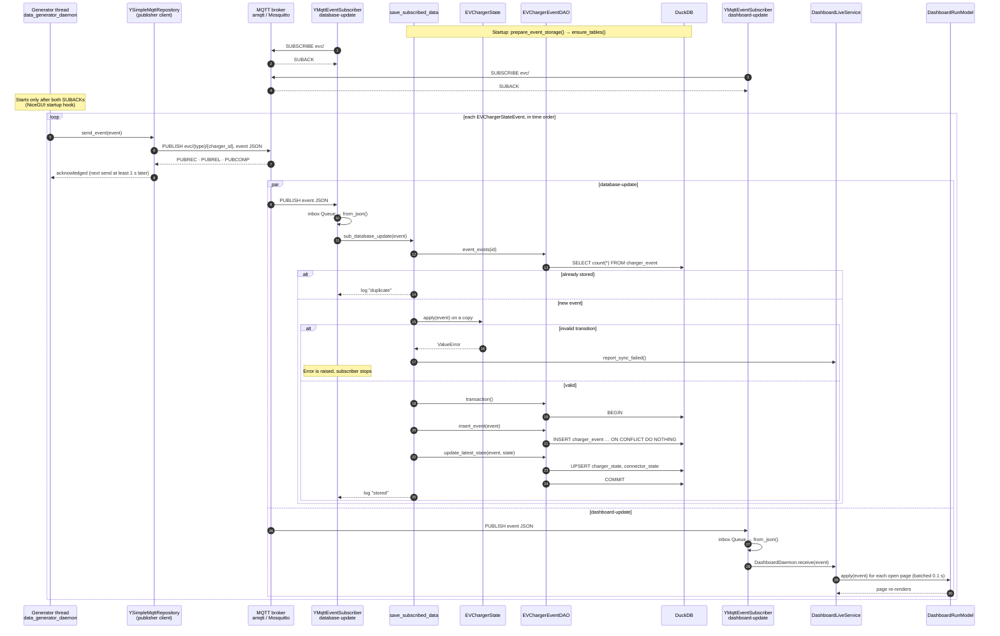

# Assignment 2 pub-sub data flow

<!-- USYD CODE CITATION ACKNOWLEDGEMENT: Claude (Anthropic) assisted with this document. -->

How a charger event travels from the generator, through the MQTT broker, to DuckDB and the
dashboard when `python main_ass_2.py` runs. Two UML views:

1. An **activity diagram with object flows**: the data flow, one swimlane per thread or component.
2. A **sequence diagram**: one event's messages, in time order.

Both are Mermaid, which GitHub and PyCharm render. The event tables themselves are described in
[`ass2_event_schema.md`](ass2_event_schema.md).

## 1. Data flow (UML activity diagram)

```mermaid
flowchart TB
    %% UML activity notation: rounded = action, rectangle = object node,
    %% diamond = decision, cylinder = «datastore», black bar = fork.

    A1[("«datastore» DuckDB nsw_evc.db<br/>Assignment 1 station tables<br/>charger_location · charger_characteristic<br/>charger_connector · charger<br/>operator · sa4_region")]

    subgraph GEN["Generator thread: data_generator_daemon"]
        START((" "))
        READ("EVChargerInfoDAO<br/>.list_generation_chargers()")
        CHARGERS["list[EVCharger]"]
        AEMO[/"AEMO NSW1<br/>wholesale prices"/]
        SIM("generate_dataset()<br/>simulate_session · dynamic_price")
        CSV["«file» data/ass2_demo/<br/>manifest.json (run_id) · stations.csv<br/>prices_hourly.csv · sessions.csv<br/>session_metering.csv"]
        BUILD("replay_events()<br/>→ generate_evc_state_update()<br/>sort by time and EVENT_TYPE_ORDER<br/>stable uuid5 event id")
        EVENT1["EVChargerStateEvent<br/>price_update · session_start<br/>meter · session_end"]
        SEND("publish_events()<br/>→ YSimpleMqttRepository.send_event()<br/>to_json() · QoS 2 · wait for ACK<br/>at least 1 s apart")
        JSON1["«file» prepared_events.json<br/>published_events.json"]
    end

    subgraph MQ["MQTT broker: amqtt inline, localhost:1883<br/>(Mosquitto with --external-broker)"]
        TOPIC["«centralBuffer»<br/>topic evc/{event_type}/{charger_id}<br/>payload: event JSON"]
        FORK[" "]
    end

    subgraph SUBDB["database-update subscriber thread"]
        RX1("YMqttEventSubscriber<br/>inbox Queue → from_json()")
        SAVE("sub_database_update()<br/>→ save_event()")
        DUP{"EVChargerEventDAO<br/>.event_exists(id)?"}
        SKIP(("✕"))
        APPLY("EVChargerState.apply(event)<br/>on a copy, cached per<br/>(run_id, charger_id)")
        VALID{"valid<br/>transition?"}
        TX("EVChargerEventDAO.transaction()<br/>insert_event()<br/>update_latest_state()")
        FAIL("report_sync_failed()<br/>raise: storage stops")
    end

    EV[("«datastore» DuckDB nsw_evc.db<br/>Event tables<br/>charger_event · charger_state<br/>connector_state")]

    subgraph SUBUI["dashboard-update subscriber thread → NiceGUI"]
        RX2("YMqttEventSubscriber<br/>inbox Queue → from_json()")
        LIVE("DashboardDaemon.receive()<br/>→ DashboardLiveService<br/>batches for 0.1 s")
        OPEN("open_page() · select_run()<br/>load_stations() · load_run()")
        MODEL("DashboardRunModel.apply(event)<br/>same EVChargerState rules")
        PAGE["Browser page<br/>map · live sessions<br/>price and energy charts"]
    end

    START --> READ
    A1 -->|"SELECT stations"| READ
    READ --> CHARGERS --> SIM
    AEMO --> SIM
    SIM --> CSV --> BUILD --> EVENT1 --> SEND
    BUILD -. "all events" .-> JSON1
    SEND -. "acknowledged events" .-> JSON1
    SEND -->|"PUBLISH"| TOPIC
    TOPIC --> FORK
    FORK -->|"copy 1"| RX1
    FORK -->|"copy 2"| RX2

    RX1 --> SAVE --> DUP
    DUP -->|"yes: replay or redelivery"| SKIP
    DUP -->|"no"| APPLY --> VALID
    EV -. "list_events() after a restart" .-> APPLY
    VALID -->|"yes"| TX
    TX -->|"INSERT charger_event<br/>UPSERT charger_state,<br/>connector_state · COMMIT"| EV
    VALID -->|"no: ValueError"| FAIL
    TX -. "FK error: ROLLBACK" .-> FAIL

    RX2 --> LIVE --> MODEL --> PAGE
    A1 -->|"EVChargerInfoDAO"| OPEN
    EV -->|"EVChargerEventDAO<br/>.list_run_events()"| OPEN
    OPEN -->|"stored events, then<br/>recent MQTT events"| MODEL

    classDef action fill:#eef4ff,stroke:#3a5ba0,color:#1b2b4b
    classDef object fill:#ffffff,stroke:#555,color:#222
    classDef store fill:#fff6e5,stroke:#b27b16,color:#3d2a05
    classDef buffer fill:#f2fbf3,stroke:#2f7d3a,color:#143a1a
    classDef decision fill:#fffbe6,stroke:#9a7b00,color:#3d3100
    classDef bar fill:#222,stroke:#222,color:#222
    classDef initial fill:#222,stroke:#222
    classDef final fill:#fff,stroke:#222,color:#222
    classDef failure fill:#fdecec,stroke:#b03a3a,color:#4b1515

    class READ,SIM,BUILD,SEND,RX1,SAVE,APPLY,TX,RX2,LIVE,OPEN,MODEL action
    class CHARGERS,EVENT1,CSV,JSON1,PAGE,AEMO object
    class A1,EV store
    class TOPIC buffer
    class DUP,VALID decision
    class FORK bar
    class START initial
    class SKIP final
    class FAIL failure
```

**Reading it**

- The broker keeps no state for the system. It forwards each `PUBLISH` to every subscription of
  `evc/#`, so both subscribers get their own copy (the fork).
- Only the `database-update` thread writes to DuckDB. The generator and the dashboard read
  through the same process-wide connection (`SharedDuckDBRepository`, `EVChargerEventDAO`),
  because DuckDB will not open the file a second time in one process.
- `✕` is a flow final: a duplicate event ends there without writing anything. The event id is a
  `uuid5` of the run, type, charger, session, connector and time, so a replay of the same run
  produces the same ids.
- The dashboard does not wait for storage. A page opens from the stored events, then applies
  the MQTT events storage may not have saved yet. `DashboardRunModel` uses the same
  `EVChargerState` rules as storage, so a page never shows a transition storage rejects.

## 2. One event (UML sequence diagram)

## 3. Where each part lives

| Part | Class or function | File |
|---|---|---|
| Wiring of all threads | `main()` | [`main_ass_2.py`](../main_ass_2.py) |
| Station read for generation | `EVChargerInfoDAO`, `EVCharger` | [`repository/evc_info_dao.py`](../repository/evc_info_dao.py), [`entity/ev_charger.py`](../entity/ev_charger.py) |
| Dataset generation | `generate_dataset()` | [`data_generator_utils.py`](../transaction_scripts/data_generation_and_publishing/data_generator_utils.py), supplied [`generate_dataset.py`](../transaction_scripts/data_generation_and_publishing/generate_dataset.py) |
| CSV rows to events | `replay_events()`, `generate_evc_state_update()` | [`data_generator_replay.py`](../transaction_scripts/data_generation_and_publishing/data_generator_replay.py), [`data_generator_utils.py`](../transaction_scripts/data_generation_and_publishing/data_generator_utils.py) |
| Publishing | `publish_events()` | [`data_generator_daemon.py`](../transaction_scripts/data_generation_and_publishing/data_generator_daemon.py) |
| Events | `YEvent`, `EVChargerStateEvent` | [`event/y_event.py`](../event/y_event.py), [`event/ev_charger_state_event.py`](../event/ev_charger_state_event.py) |
| MQTT client and inline broker | `YSimpleMqttRepository` | [`data_utils/y_mqtt_simple_repo.py`](../data_utils/y_mqtt_simple_repo.py) |
| Subscriber threads | `YMqttEventSubscriber`, `subscribed()` | [`data_utils/y_mqtt_event_subscriber.py`](../data_utils/y_mqtt_event_subscriber.py) |
| Event storage | `sub_database_update()`, `save_event()` | [`save_subscribed_data.py`](../transaction_scripts/stateful_event_storage/save_subscribed_data.py) |
| State transitions | `EVChargerState.apply()` | [`entity/ev_charger_state.py`](../entity/ev_charger_state.py) |
| Event SQL | `EVChargerEventDAO` | [`repository/evc_event_dao.py`](../repository/evc_event_dao.py) |
| Shared DuckDB connection | `cursor()`, `transaction()` | [`repository/utils/duckdb_utils.py`](../repository/utils/duckdb_utils.py), [`data_utils/duckdb_repo.py`](../data_utils/duckdb_repo.py) |
| Dashboard live updates | `DashboardDaemon`, `DashboardLiveService`, `DashboardRunModel` | [`view/dashboard_daemon.py`](../view/dashboard_daemon.py), [`view/dashboard_live.py`](../view/dashboard_live.py), [`view/dashboard_model.py`](../view/dashboard_model.py) |
| Dashboard page reads | `load_stations()`, `load_run()` | [`view/dashboard_data.py`](../view/dashboard_data.py) |
